<p align="center">
  
</p>

# Magic Editor X

Block editor for Strapi 5: an [Editor.js](https://editorjs.io/) custom field with Media Library uploads, custom blocks, version history, live collaboration across several servers and an optional AI assistant that uses your own provider. Free and open source under the MIT license.

[](https://www.npmjs.com/package/magic-editor-x)
[](./LICENSE)

Live docs: <https://schero94.github.io/Magic-Editor-X/>

## Contents

- [Features](#features)
- [Screenshots](#screenshots)
- [Core concepts](#core-concepts)
- [Screens](#screens)
- [Compatibility](#compatibility)
- [Install](#install)
- [Configuration](#configuration)
- [Live collaboration](#live-collaboration)
- [Running several instances](#running-several-instances)
- [AI assistant](#ai-assistant)
- [Field presets](#field-presets)
- [Writing tools](#writing-tools)
- [Paste, import and migration](#paste-import-and-migration)
- [Version history](#version-history)
- [Quality checks](#quality-checks)
- [Data format](#data-format)
- [Rendering content](#rendering-content)
- [Admin API and permissions](#admin-api-and-permissions)
- [Security and privacy](#security-and-privacy)
- [Troubleshooting](#troubleshooting)
- [Migrating from 1.x](#migrating-from-1x)
- [Development and tests](#development-and-tests)
- [Maintenance status](#maintenance-status)
- [Languages](#languages)
- [License](#license)

## Features

Every feature is available in every installation. There is nothing to activate, no tiers and no usage limits, and the plugin makes no outgoing requests unless you use a feature that needs one (link previews, image by URL, AI assistant).

- **Custom field** `plugin::magic-editor-x.richtext` (stored as JSON) for collection types, single types, components and dynamic zones, including localised fields and Draft & Publish.
- **Block tools** (block name in brackets, the same names 1.x used):
  - text: paragraph (`paragraph`), heading H1 to H6 (`header`), list with nesting, ordered and unordered (`list`), checklist (`checklist`), quote (`quote`), warning (`warning`), alert in eight colours (`alert`), collapsible toggle (`toggle`), delimiter (`delimiter`), table (`table`);
  - code: plain code (`code`), code with syntax highlighting (`codeFlask`; Prism with JavaScript, TypeScript, JSX/TSX, JSON, HTML, CSS/SCSS, PHP, Python, Ruby, Go, Rust, Java, Kotlin, Swift, C, C++, C#, SQL, Bash, YAML, Markdown, GraphQL, Docker and diff);
  - media: image upload by file or URL into the Media Library (`image`), picking images from the Media Library (`mediaLib`, inserts `image` blocks), image by URL without upload (`simpleImage`), file attachments (`attaches`), embeds such as YouTube, Vimeo, CodePen, GitHub, Figma and others (`embed`);
  - other: link preview card (`linkTool`), person card (`personality`), call-to-action button (`button`), raw HTML (`raw`).
- **Inline tools:** bold, italic, link with target and rel (`hyperlink`, with a built-in picker that links an entry of your content types, see [Internal links](#internal-links)), marker, underline, strikethrough, inline code, tooltip, and the AI assistant when it is enabled.
- **Block tunes:** alignment (`alignmentTune`), text variant call-out / citation / details (`textVariant`), indent (`indentTune`).
- **Field presets:** per field in the Content-Type Builder: allowed blocks and heading levels, character and block limits, required alternative text, allowed links, AI and live collaboration on or off, publishing guard. Enforced on every save and over the live channel, not only in the editor. See [Field presets](#field-presets).
- **Writing:** Markdown shortcuts (`#`, `-`, `1.`, `[]`, `>`, ` ``` `, `---`, `**bold**`, `_italic_`, `~~strike~~`, `` `code` ``), find and replace, keyboard shortcut help, focus mode, actions for several selected blocks, counts with reading time, undo and redo, drag and drop, full screen. See [Writing tools](#writing-tools).
- **Paste and import:** Word, Google Docs, LibreOffice, web pages and Markdown become real blocks; a CLI migrates Strapi Blocks, Markdown and HTML fields. See [Paste, import and migration](#paste-import-and-migration).
- **Media:** alternative text and "decorative image" on image blocks; images keep their Media Library id and responsive formats.
- **Quality checks:** accessibility lint (alternative texts, heading order, link texts, table headers, contrast of custom colours) and a link check, with an optional publishing guard. See [Quality checks](#quality-checks).
- **Renderers, schema and types:** `magic-editor-x/render` (HTML, plain text, Markdown; framework-free and XSS-safe), `magic-editor-x/schema` (JSON Schema) and `magic-editor-x/types` (TypeScript). See [Rendering content](#rendering-content).
- **Custom blocks:** define your own blocks in Settings: simple blocks with fields (text, textarea, URL, number, select, checkbox, image, colour) and an optional HTML template, or embedded-entry blocks that link an entry of another content type. Import and export as JSON.
- **Version history:** named versions, a word-level comparison with the current content, restore of the whole field or a single block; automatic versions during live sessions.
- **Live collaboration:** several admins edit the same field at the same time with character-level merging, presence avatars and read-only viewers. Works with several Node processes behind a load balancer without sticky sessions.
- **AI assistant:** improve, fix grammar, shorten, expand, summarize, simplify, translate, change tone and continue writing, using Anthropic, OpenAI or any OpenAI-compatible server (for example a local model) with your own key.
- **Strapi-native admin:** built with the Strapi Design System, light and dark mode, keyboard accessible, admin in English, German, French, Spanish and Portuguese.
- **Safe content:** every value is normalised and sanitised on the server when it is saved, from the Content Manager, the Content API or code.

## Screenshots

|                                                                                   |                                                                                |
| --------------------------------------------------------------------------------- | ------------------------------------------------------------------------------ |
| 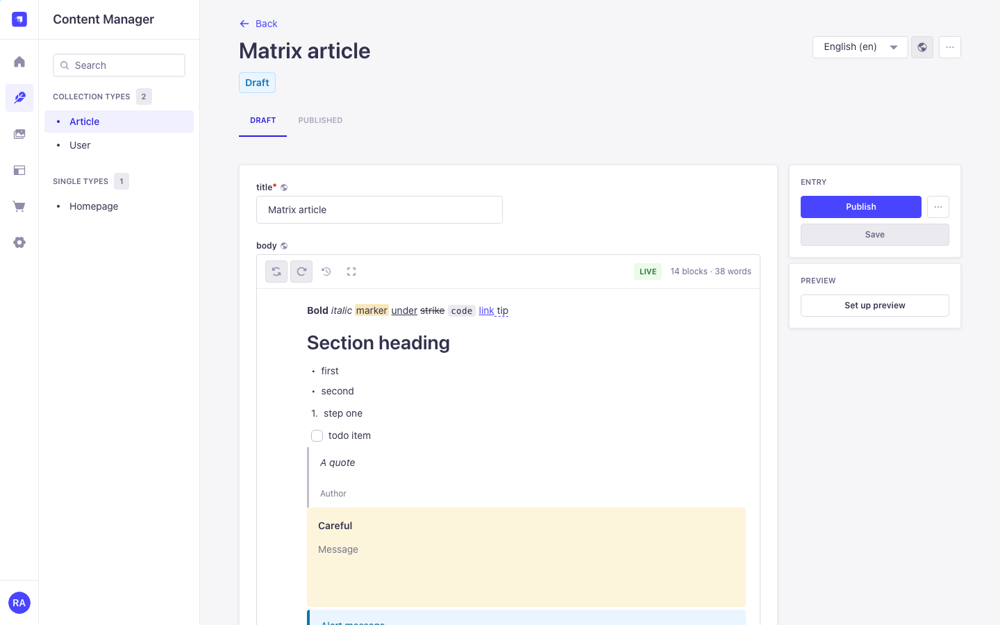 | 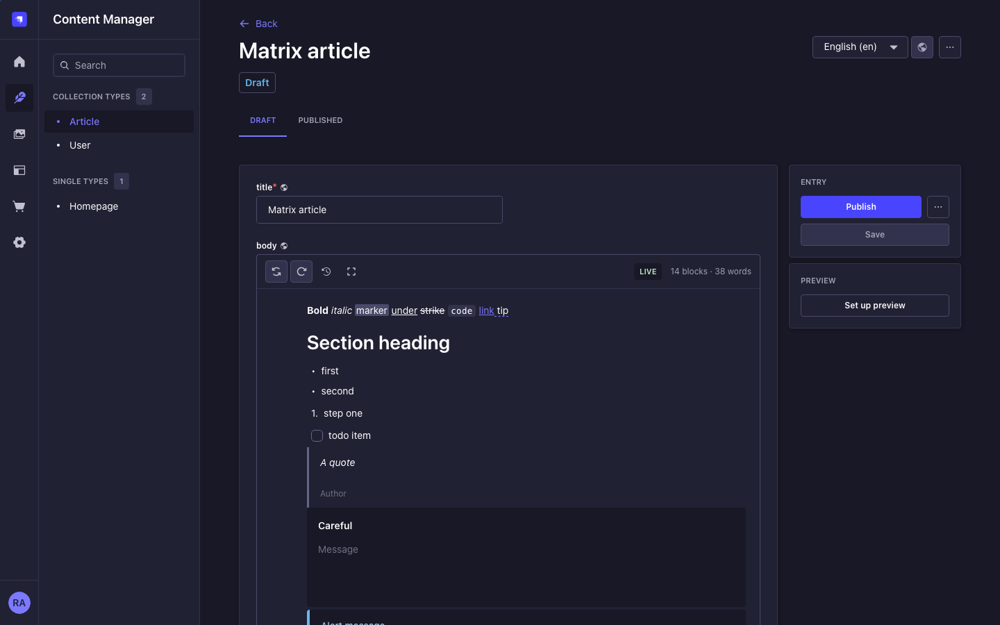                     |
| 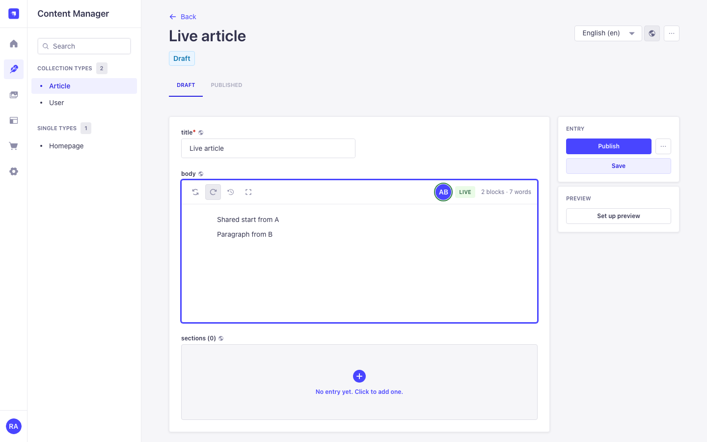        | 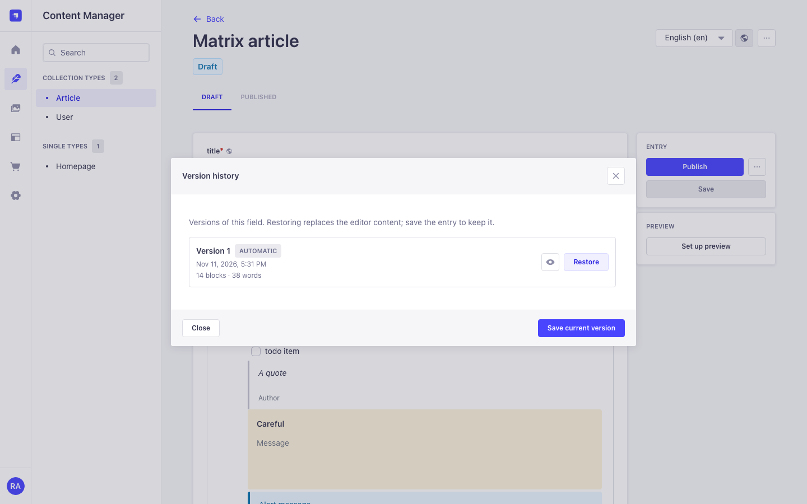                      |
| 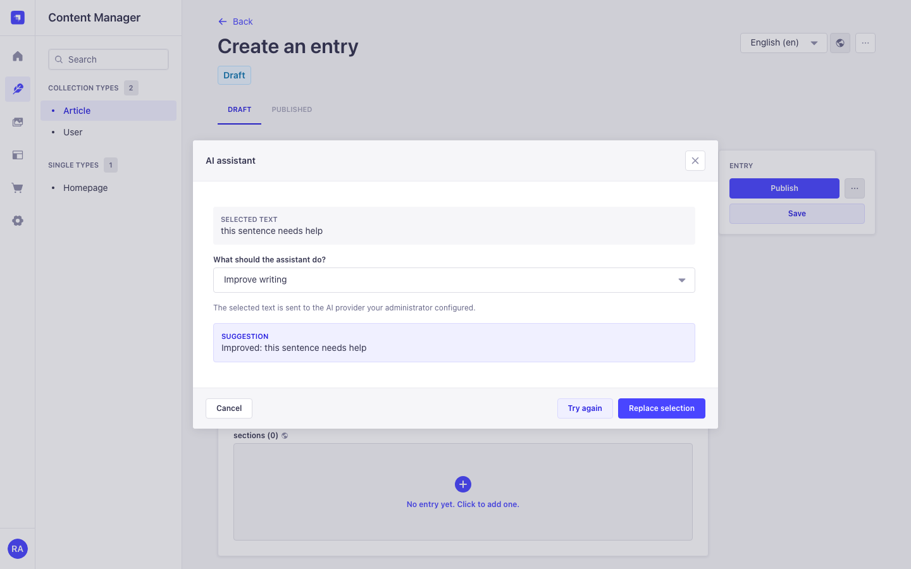                                 | 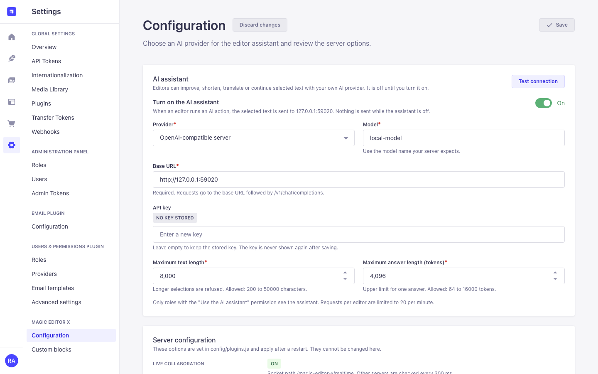 |
| 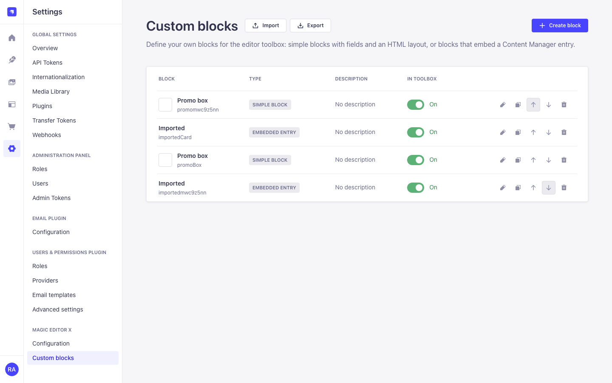    | 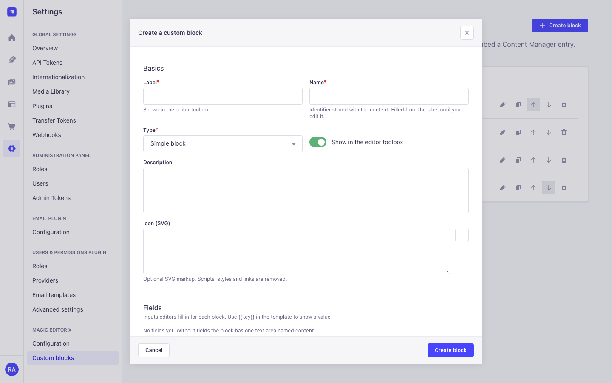                |

| 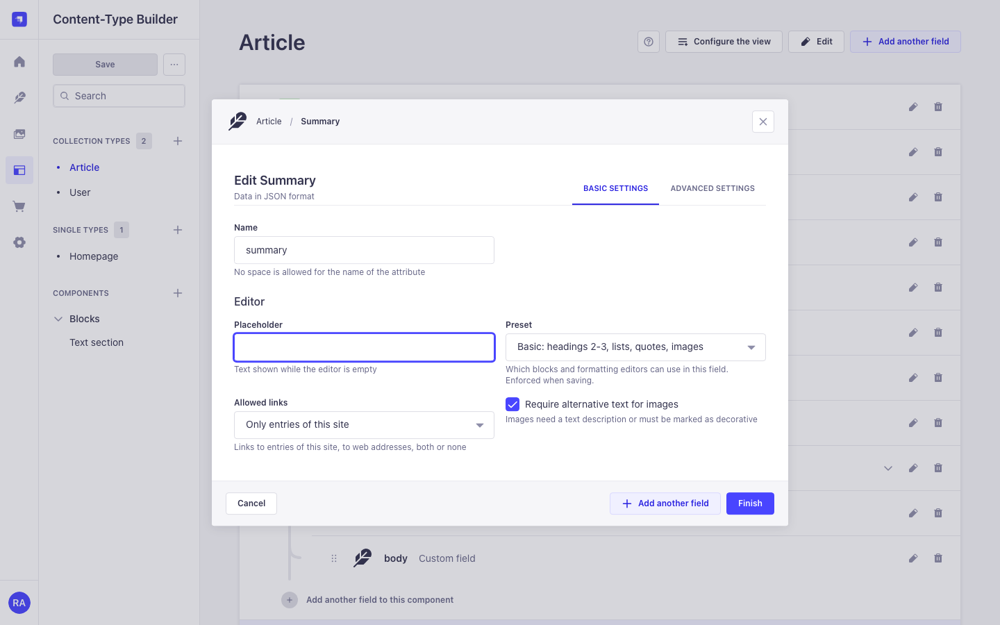 | 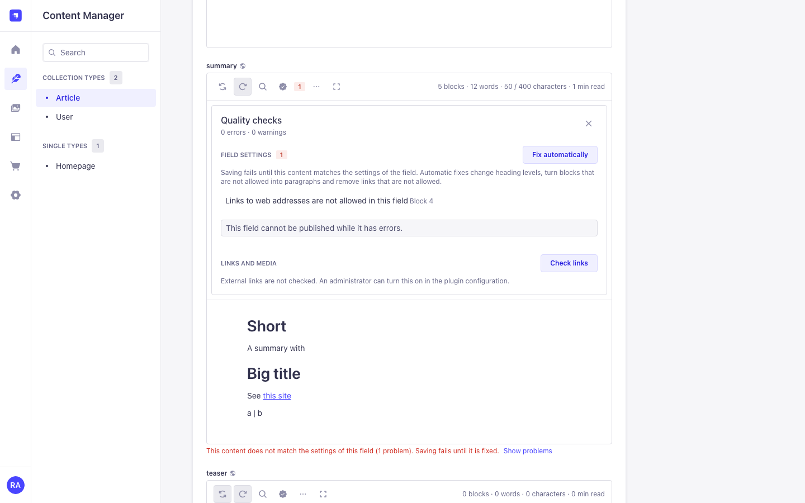 |
| 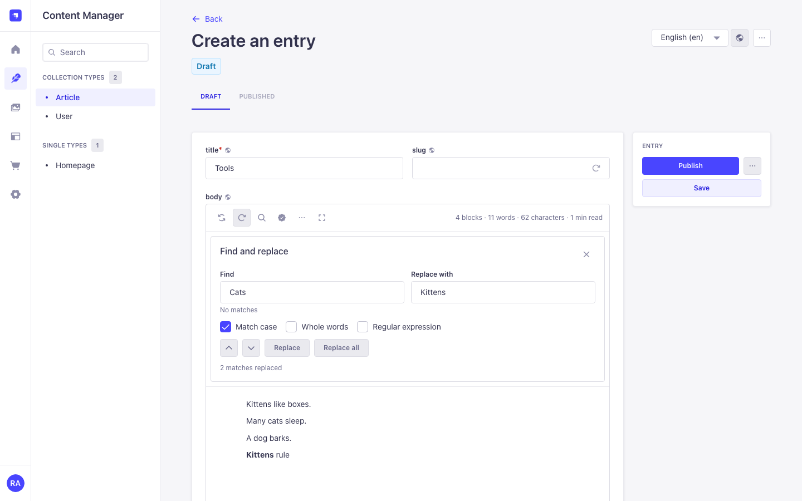 | 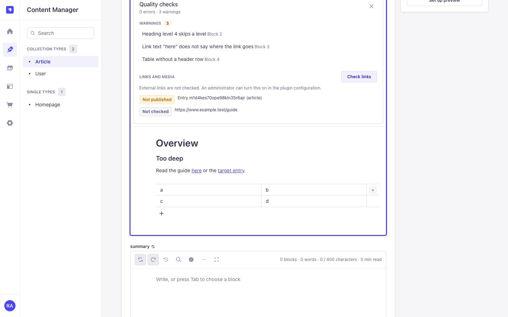 |
| 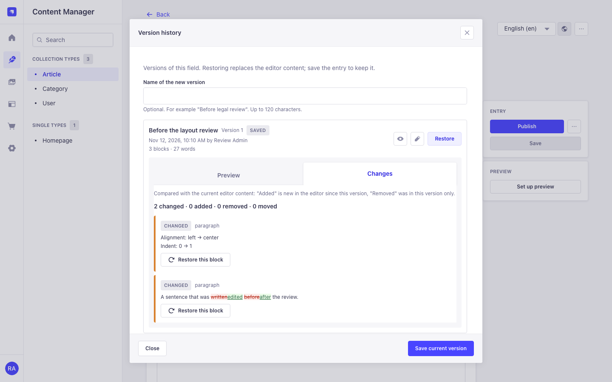 | 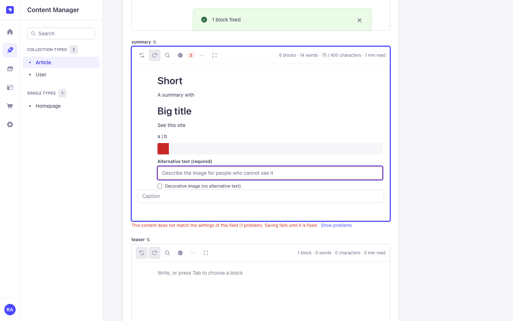 |
| 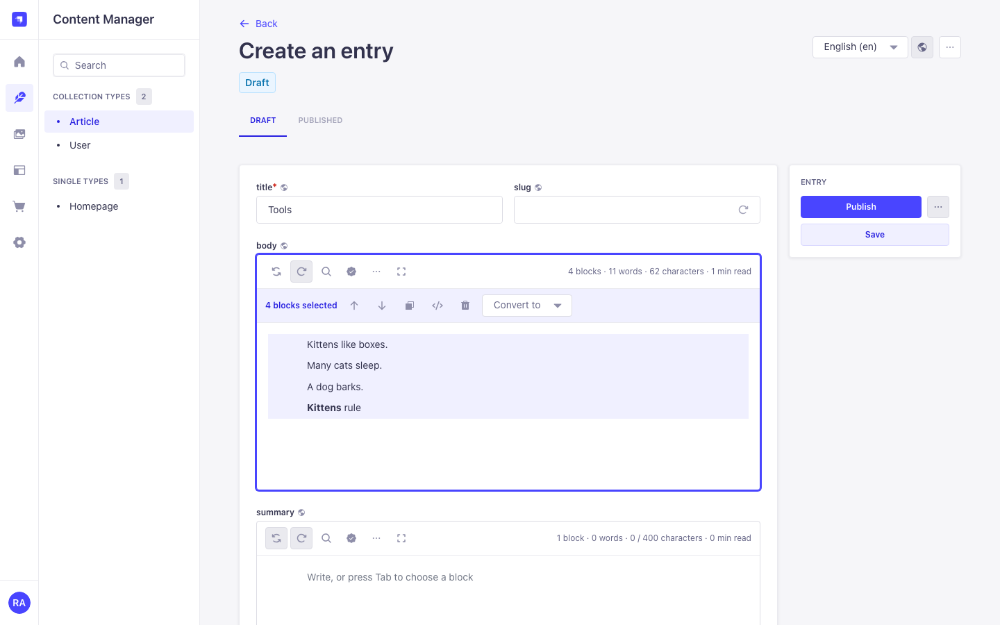 | 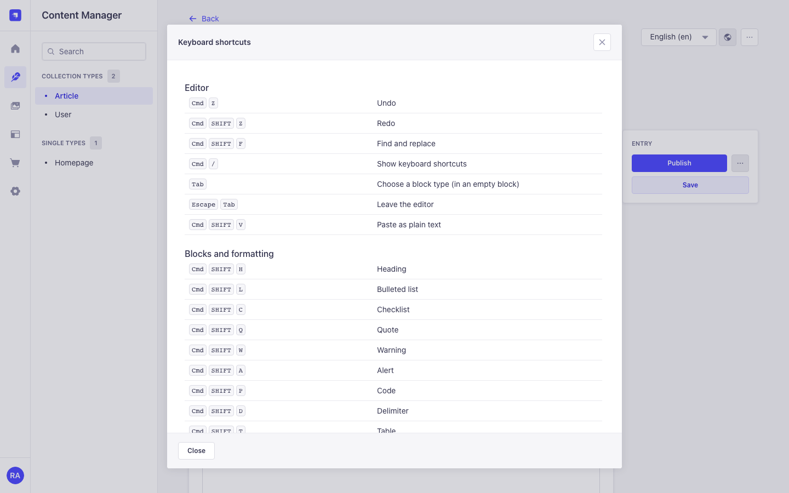 |

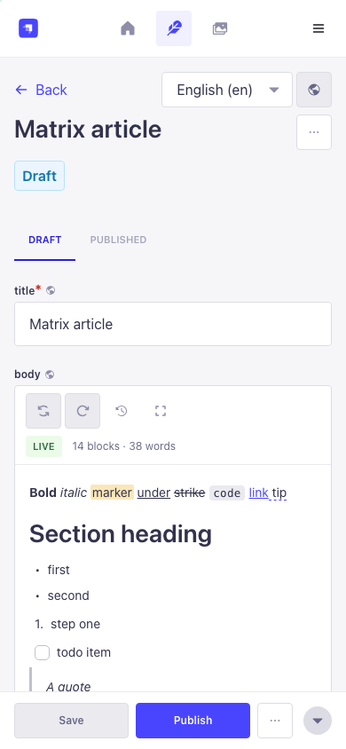

All screenshots use synthetic data.

## Core concepts

| Term         | Meaning                                                                                                                                                 |
| ------------ | ------------------------------------------------------------------------------------------------------------------------------------------------------- |
| Field        | One Magic Editor X attribute of a content type or component. Its value is an Editor.js document.                                                        |
| Block        | One entry of the document's `blocks` array, for example a paragraph or an image. Each block has an `id`, a `type` (the block name) and `data`.          |
| Custom block | A block type defined in Settings > Magic Editor X > Custom blocks. Its name becomes the block `type`.                                                   |
| Version      | A stored copy (snapshot) of one field of one document in one locale, listed in the version history.                                                     |
| Room         | The live editing session of one field of one document in one locale. A room exists while people edit and for `collaboration.roomTtlMinutes` afterwards. |
| Viewer       | Someone in a room who can read the document but not update it. Viewers see changes live but cannot type.                                                |

## Screens

| Screen                         | Where                                                                   | Who can open it                                                                                                                                                 |
| ------------------------------ | ----------------------------------------------------------------------- | --------------------------------------------------------------------------------------------------------------------------------------------------------------- |
| Editor field                   | Content Manager, edit view                                              | Everyone who can read the field. Uploads, version history and the AI assistant need the permissions in [Admin API and permissions](#admin-api-and-permissions). |
| Version history                | Clock button in the editor toolbar of a saved document                  | `access` and Content Manager read on the document; saving, naming and restoring need update.                                                                    |
| Find and replace               | Magnifier button, or Ctrl/Cmd+Shift+F in the editor                     | Everyone who can read the field; replacing needs update.                                                                                                        |
| Quality checks                 | Seal button in the editor toolbar (the number counts problems)          | Everyone who can read the field; the link check needs `access`.                                                                                                 |
| Keyboard shortcuts, focus mode | More (…) button, or Ctrl/Cmd+/                                          | Everyone who can read the field.                                                                                                                                |
| Field options                  | Content-Type Builder, Magic Editor X field, Basic and Advanced settings | Content-Type Builder access (development mode).                                                                                                                 |
| AI assistant                   | Inline toolbar (select text)                                            | `access` and `ai.use`, when an administrator turned the assistant on.                                                                                           |
| Configuration                  | Settings > Magic Editor X > Configuration                               | `settings.read` (view), `settings.update` (edit).                                                                                                               |
| Custom blocks                  | Settings > Magic Editor X > Custom blocks                               | `custom-blocks.manage`.                                                                                                                                         |

## Compatibility

| Plugin | Strapi                                         | Node     | Notes                                                                                                                       |
| ------ | ---------------------------------------------- | -------- | --------------------------------------------------------------------------------------------------------------------------- |
| 2.x    | 5.38 or later (acceptance host: Strapi 5.61.1) | 22 or 24 | SQLite, PostgreSQL and MySQL/MariaDB through the Strapi database connection. Acceptance runs used SQLite and PostgreSQL 16. |
| 1.x    | 5.x                                            | 22       | No longer developed.                                                                                                        |

The admin uses the React, React Router, react-intl, styled-components and Design System versions of the Strapi admin (React 18, Design System 2.2.4).

## Install

```bash
npm install magic-editor-x
```

Enable the plugin in `config/plugins.ts` (or `config/plugins.js`):

```ts
export default ({ env }) => ({
  'magic-editor-x': {
    enabled: true,
    config: {
      // optional, see Configuration
    },
  },
});
```

Then rebuild the admin and restart:

```bash
npm run build
npm run develop
```

Add the field in the Content-Type Builder: **Add another field > Custom > Magic Editor X**. In its settings you can set a placeholder, a preset and the other [field presets](#field-presets), and a minimum height (120 to 2000 px).

After the first start, Super Admins can use everything. Other roles need the plugin actions listed in [Admin API and permissions](#admin-api-and-permissions) (Settings > Administration Panel > Roles > Plugins > Magic Editor X).

## Configuration

### Reference

All keys are optional. Infrastructure options live in `config/plugins`; the AI provider is edited at runtime in Settings > Magic Editor X > Configuration.

| Key                                                       | Type                                     | Default                                                                                           | Effect                                                                                                                                                                                                                                                                                                                                                                          |
| --------------------------------------------------------- | ---------------------------------------- | ------------------------------------------------------------------------------------------------- | ------------------------------------------------------------------------------------------------------------------------------------------------------------------------------------------------------------------------------------------------------------------------------------------------------------------------------------------------------------------------------- |
| `debug`                                                   | boolean                                  | `false`                                                                                           | Writes debug log lines (never content or personal data).                                                                                                                                                                                                                                                                                                                        |
| `rawHtml`                                                 | `'sanitize'` \| `'allow'` \| `'disable'` | `'sanitize'`                                                                                      | Raw HTML block on save: `sanitize` removes scripts, event handlers, iframes and unsafe URLs; `allow` stores the HTML as typed; `disable` empties it.                                                                                                                                                                                                                            |
| `sanitizeOnSave`                                          | boolean                                  | `true`                                                                                            | Normalise and sanitise Magic Editor X values on every Document Service write. Turning this off is not recommended.                                                                                                                                                                                                                                                              |
| `encryptionKey`                                           | string (32+ characters)                  | unset                                                                                             | Key for the stored AI provider key. Prefer the `MAGIC_EDITOR_X_ENCRYPTION_KEY` environment variable.                                                                                                                                                                                                                                                                            |
| `uploads.maxImageBytes`                                   | integer                                  | `10485760` (10 MiB)                                                                               | Largest image accepted by file or URL (hard cap 500 MiB).                                                                                                                                                                                                                                                                                                                       |
| `uploads.maxFileBytes`                                    | integer                                  | `20971520` (20 MiB)                                                                               | Largest attachment.                                                                                                                                                                                                                                                                                                                                                             |
| `linkPreview.enabled`                                     | boolean                                  | `true`                                                                                            | Link preview cards. When `false`, `GET /magic-editor-x/link` answers 404.                                                                                                                                                                                                                                                                                                       |
| `linkPreview.timeoutMs`                                   | integer                                  | `8000`                                                                                            | Time limit for fetching a page (1000 to 30000).                                                                                                                                                                                                                                                                                                                                 |
| `api.autoParseJSON`                                       | boolean                                  | `true`                                                                                            | Turn 1.x JSON strings into objects in Content API GET responses.                                                                                                                                                                                                                                                                                                                |
| `ai.allowPrivateBaseUrl`                                  | boolean                                  | `false`                                                                                           | Allow AI base URLs on loopback or private networks (for local models). Owner decision; not editable in the admin.                                                                                                                                                                                                                                                               |
| `ai.apiKey`                                               | string                                   | unset                                                                                             | Provider key from the environment. When set it wins over a key stored in the settings.                                                                                                                                                                                                                                                                                          |
| `ai.requestsPerMinute`                                    | integer                                  | `20`                                                                                              | AI requests per admin per minute, counted per process.                                                                                                                                                                                                                                                                                                                          |
| `ai.timeoutMs`                                            | integer                                  | `60000`                                                                                           | Time limit for one provider request.                                                                                                                                                                                                                                                                                                                                            |
| `collaboration.enabled`                                   | boolean                                  | `true`                                                                                            | Live collaboration and its Socket.IO server.                                                                                                                                                                                                                                                                                                                                    |
| `collaboration.path`                                      | string                                   | `'/magic-editor-x/realtime'`                                                                      | Socket.IO path on the Strapi HTTP server.                                                                                                                                                                                                                                                                                                                                       |
| `collaboration.allowedOrigins`                            | string[]                                 | `[]`                                                                                              | Extra browser origins allowed to open the socket. The admin URL and the server URL are always allowed.                                                                                                                                                                                                                                                                          |
| `collaboration.pollIntervalMs`                            | integer                                  | `400`                                                                                             | How often each process reads updates written by other processes (50 to 10000).                                                                                                                                                                                                                                                                                                  |
| `collaboration.roomTtlMinutes`                            | integer                                  | `30`                                                                                              | Keep a room's live state this long after the last person left.                                                                                                                                                                                                                                                                                                                  |
| `collaboration.maxMessageBytes`                           | integer                                  | `2097152` (2 MiB)                                                                                 | Largest accepted socket message.                                                                                                                                                                                                                                                                                                                                                |
| `collaboration.snapshotIntervalMinutes`                   | integer                                  | `10`                                                                                              | Automatic version while people edit live. `0` turns it off.                                                                                                                                                                                                                                                                                                                     |
| `collaboration.tokenTtlSeconds`                           | integer                                  | `60`                                                                                              | Lifetime of the one-time token that opens the socket.                                                                                                                                                                                                                                                                                                                           |
| `collaboration.maxConnectionsPerAdmin`                    | integer                                  | `20`                                                                                              | Open live sockets per admin across all processes.                                                                                                                                                                                                                                                                                                                               |
| `collaboration.maxRoomsPerAdmin`                          | integer                                  | `20`                                                                                              | Different fields one admin may have open live at the same time, across all processes.                                                                                                                                                                                                                                                                                           |
| `collaboration.revalidateSeconds`                         | integer                                  | `60`                                                                                              | Full permission re-check of open sockets. Role, permission and user changes are applied within about a second anyway.                                                                                                                                                                                                                                                           |
| `collaboration.rateLimit`                                 | object                                   | `{ sessionsPerMinute: 60, updatesPer10s: 300, bytesPer10s: 8388608 }`                             | Session tokens per admin and minute (shared by all processes), updates and update bytes per socket in 10 seconds.                                                                                                                                                                                                                                                               |
| `collaboration.compaction`                                | object                                   | `{ enabled: true, idleSeconds: 60, minBytes: 262144, ratio: 4, checkIntervalSeconds: 30 }`        | Rebuilds an idle room whose live state is `ratio` times larger than a fresh copy (and at least `minBytes`) as a new generation, once across all processes. Open editors switch without reconnecting; edits that had not reached the server yet are kept. Bounds: `idleSeconds` 15 to 86400, `minBytes` 1 KiB to 512 MiB, `ratio` 1.5 to 1000, `checkIntervalSeconds` 1 to 3600. |
| `history.maxSnapshotsPerField`                            | integer                                  | `50`                                                                                              | Versions kept per field and locale; older ones are deleted.                                                                                                                                                                                                                                                                                                                     |
| `comments.enabled`                                        | boolean                                  | `true`                                                                                            | Block comments in the editor. `false` hides them and the comment routes answer 404.                                                                                                                                                                                                                                                                                             |
| `comments.perMinute`                                      | integer                                  | `30`                                                                                              | New comments and replies one admin may post per minute, shared by all processes (1 to 1000).                                                                                                                                                                                                                                                                                    |
| `links.urlPattern`                                        | string                                   | `''`                                                                                              | `href` of internal links, for example `'/{locale}/{collection}/{slug}'` or `'https://www.example.com/{collection}/{documentId}'`. Placeholders: `{documentId}`, `{locale}`, `{slug}`, `{collection}`, `{singular}`. Empty means `'/{collection}/{documentId}'`. See [Internal links](#internal-links).                                                                          |
| `qualityChecks.externalLinks`                             | object                                   | `{ enabled: false, timeoutMs: 5000, perMinute: 30 }`                                              | External link check of the quality panel; keys below.                                                                                                                                                                                                                                                                                                                           |
| `qualityChecks.externalLinks.enabled`                     | boolean                                  | `false`                                                                                           | Lets the quality panel check external links (outgoing requests through the SSRF-protected fetcher; owner opt-in).                                                                                                                                                                                                                                                               |
| `qualityChecks.externalLinks.timeoutMs`                   | integer                                  | `5000`                                                                                            | Time limit per request and per redirect hop (1000 to 15000).                                                                                                                                                                                                                                                                                                                    |
| `qualityChecks.externalLinks.perMinute`                   | integer                                  | `30`                                                                                              | External URLs one admin may check per minute, shared by all processes.                                                                                                                                                                                                                                                                                                          |
| `qualityChecks.externalLinks.allowPrivateOrigins`         | string[]                                 | `[]`                                                                                              | Exact origins (for example an intranet host) that the link checks may reach although they resolve to a private address. Redirects from them are never followed.                                                                                                                                                                                                                 |
| `qualityChecks.externalLinks.schedule`                    | object                                   | `{ enabled: false, rule: '0 3 * * *', maxUrlsPerRun: 500, perMinute: 60, perHostConcurrency: 2 }` | Scheduled check of every external link in all editor fields (needs `externalLinks.enabled`); keys below.                                                                                                                                                                                                                                                                        |
| `qualityChecks.externalLinks.schedule.enabled`            | boolean                                  | `false`                                                                                           | Runs the scheduled check. One process in a cluster runs each check (lease).                                                                                                                                                                                                                                                                                                     |
| `qualityChecks.externalLinks.schedule.rule`               | string                                   | `'0 3 * * *'`                                                                                     | Cron rule (server time).                                                                                                                                                                                                                                                                                                                                                        |
| `qualityChecks.externalLinks.schedule.maxUrlsPerRun`      | integer                                  | `500`                                                                                             | Distinct URLs checked per run (1 to 10000).                                                                                                                                                                                                                                                                                                                                     |
| `qualityChecks.externalLinks.schedule.perMinute`          | integer                                  | `60`                                                                                              | Requests per minute for the whole run (1 to 600).                                                                                                                                                                                                                                                                                                                               |
| `qualityChecks.externalLinks.schedule.perHostConcurrency` | integer                                  | `2`                                                                                               | Requests in flight per host (1 to 8).                                                                                                                                                                                                                                                                                                                                           |

The validator rejects wrong types and ranges at startup and names the key, never the value. Keys from 1.x that no longer exist are ignored with a warning; see [Migrating from 1.x](#migrating-from-1x).

### Environment variables

| Name                            | Required                                | Default | Effect                                                                                                                                                                                                                                                                                                                                                                                       |
| ------------------------------- | --------------------------------------- | ------- | -------------------------------------------------------------------------------------------------------------------------------------------------------------------------------------------------------------------------------------------------------------------------------------------------------------------------------------------------------------------------------------------- |
| `MAGIC_EDITOR_X_ENCRYPTION_KEY` | Only to store an AI key in the settings | unset   | 32 or more characters. Encrypts the AI provider key (AES-256-GCM). Without it the settings page cannot store a key; you can still pass one with `ai.apiKey`. Generate one with `node -e "console.log(require('crypto').randomBytes(32).toString('base64'))"`. Keep it stable: a different key makes a stored provider key unreadable, and the settings page then asks you to enter it again. |

The plugin also uses Strapi's own `admin.auth.secret` (`ADMIN_JWT_SECRET`) to sign collaboration tokens. Every process of a cluster must use the same value.

### AI settings (admin)

Settings > Magic Editor X > Configuration stores these values in the Strapi store:

| Setting              | Default                                                                                                    | Range                                                                        |
| -------------------- | ---------------------------------------------------------------------------------------------------------- | ---------------------------------------------------------------------------- |
| Enabled              | off                                                                                                        |                                                                              |
| Provider             | `anthropic`                                                                                                | `anthropic`, `openai`, `openai-compatible`                                   |
| Base URL             | provider default (`https://api.anthropic.com`, `https://api.openai.com`); required for `openai-compatible` | https, or private hosts when `ai.allowPrivateBaseUrl` is on                  |
| Model                | `claude-opus-5-5` (Anthropic), `gpt-6-luna` (OpenAI)                                                       | letters, digits and `._:/@-`                                                 |
| API key              | none                                                                                                       | never returned; changing the provider or base URL requires entering it again |
| Max input characters | 8000                                                                                                       | 200 to 50000                                                                 |
| Max output tokens    | 4096                                                                                                       | 64 to 16000                                                                  |

## Live collaboration

When a document has been saved once, the editor joins the room of its field. Everyone with Content Manager read access to that document, locale and field and the `collaborate` action can join; people with update access can type, others watch as viewers.

How it works:

- **Conflict-free structure.** The field is shared as a Yjs document in which every block has a stable id and every part of its data has its own shared type: texts merge character by character, and every table cell, list item, checklist entry, tune (alignment, text variant, indent) and custom block field is merged separately. Two people can edit different cells of one table, different items of one list, or the text and the alignment of one paragraph at the same time and both changes are kept. When two people change the same number, switch or option at the same moment, one value wins on every screen. The stored Editor.js JSON does not change.
- **Presence.** Avatars with first name and last initial (never e-mail addresses), coloured carets and selections of the others in the text, a coloured marker at the block someone is editing and an "away" state after a minute without activity or when the tab is hidden. Joins and leaves are announced politely to screen readers. Colours follow the light and dark theme; the caret does not blink when reduced motion is requested.
- **Connection state** in the toolbar: Connecting, Syncing, Live, Reconnecting, Offline, View only, or Live editing unavailable.
- **Offline and reconnects.** You can keep typing while the connection is gone. Unsent changes are kept, sent again after the reconnect and merged with what others did meanwhile, without duplicates. Reconnects use exponential backoff with jitter and a new one-time token; waking a laptop or returning to a tab reconnects at once. Closing the tab leaves the room immediately.
- **Undo and redo** (toolbar, Cmd/Ctrl+Z, Shift+Cmd/Ctrl+Z) only revert your own changes, never what others typed (the last 200 steps).
- **Saving.** Changes made by others become part of your form. Save, publish and discard work as usual. Version history restores into the live room, so everyone sees the restored content. Each locale has its own room.
- **Permissions** are checked when you join, re-checked within about a second when roles, permissions or users change (on every process), and every `collaboration.revalidateSeconds`. An admin who loses update access becomes a viewer; one who loses read access is disconnected.
- **Nothing typed is lost.** Edits are stored in the database before they are confirmed. When a room is cleaned up `collaboration.roomTtlMinutes` after the last person left and contains edits nobody saved, a version is created first, so they can be restored from the history.

Limits:

- A new entry that has not been saved yet has no room.
- Text formatting (bold, links, …) is part of the text; two people formatting the same word at the same moment can produce nested tags, which the sanitiser keeps valid.
- Up to 5000 blocks per field (the stored-content limit); rooms above 64 MiB of history refuse further edits until they are compacted.

## Running several instances

Collaboration works with several Node processes and several machines that share one database, for example Railway with 2 replicas and pm2 with 4 processes each, behind a load balancer **without sticky sessions**. No Redis is needed.

How it works:

- The browser connects with the WebSocket transport only. A WebSocket connection is one long-lived request, so it does not need sticky routing. Your proxy must allow WebSocket upgrades on `collaboration.path` (default `/magic-editor-x/realtime`) and send them to Strapi.
- The session token is signed with a key derived from `admin.auth.secret`, so any process can accept a token issued by another one. All processes must use the same `ADMIN_JWT_SECRET`.
- Every update is written to the table `magic_editor_x_collab_updates` before it is acknowledged. Other processes read new rows every `collaboration.pollIntervalMs` and send them to their own sockets.
- Presence is stored in `magic_editor_x_collab_presence` with heartbeats; leases and one-time keys in `magic_editor_x_locks`. Seeding a room, compaction, automatic versions and cleanup each run once across all processes.
- Every process keeps the active rooms in memory, checks every update before it is stored (only the structures the editor uses, every dependency present, every touched block valid within the content limits) and relays it.
- Clients resynchronise their state every 20 seconds and after each reconnect, so a process restart or deploy loses nothing that was acknowledged.
- Permission changes set a signal in `magic_editor_x_locks` that every process checks every second. Session and AI rate limits are counted in `magic_editor_x_counters`, so they apply to the whole cluster.

The plugin creates these four tables on startup. They are not content types, so Strapi's schema sync leaves them alone.

Behind a proxy, also set `server.proxy` in `config/server` (`koa: true` and the number of trusted hops in `maxIpsCount`) so Strapi sees the real client address.

The acceptance run with several processes is described in [CONTRIBUTING.md](./CONTRIBUTING.md).

## AI assistant

The assistant is off until an administrator turns it on in Settings > Magic Editor X > Configuration and gives it a provider:

| Provider                                                | Request                                                                             | Default model (2026-11-11) |
| ------------------------------------------------------- | ----------------------------------------------------------------------------------- | -------------------------- |
| Anthropic                                               | `POST {base}/v1/messages`, headers `x-api-key` and `anthropic-version: 2026-10-21`  | `claude-opus-5-5`          |
| OpenAI                                                  | `POST {base}/v1/chat/completions`, `Authorization: Bearer`, `max_completion_tokens` | `gpt-6-luna`               |
| OpenAI-compatible (Ollama, vLLM, LM Studio and similar) | `POST {base}/v1/chat/completions`, optional bearer key, `max_tokens`                | none; you name the model   |

- The key stays on the server. It is encrypted at rest with `MAGIC_EDITOR_X_ENCRYPTION_KEY` or read from `ai.apiKey`, and it is never sent to the browser or written to logs.
- The selected text (with its inline formatting) and a fixed instruction are sent to the provider. Nothing else from the document is sent. The text is never logged.
- Base URLs must be public https URLs. Loopback and private hosts are allowed only with `ai.allowPrivateBaseUrl: true` in `config/plugins`. Redirects are not followed.
- Input is limited by "Max input characters", output by "Max output tokens". Each admin can send `ai.requestsPerMinute` requests per minute; the counter is shared by all processes.
- The answer is sanitised to the inline tags the editor uses before it reaches the browser. The admin reviews the suggestion and chooses Replace selection; nothing changes before that.

## Field presets

Each Magic Editor X field can have its own rules, set in the Content-Type Builder (field settings). They are stored as custom field options in the schema and enforced in three places with the same code (`shared/presets.mjs`): the editor offers only what the field allows, the realtime server refuses new blocks a preset does not allow, and every write (Content Manager, Content API, imports, code) is checked by the Document Service middleware.

| Option (`options.*`)   | Where in the field settings | Values                                                                            | Effect                                                                                                                                                                |
| ---------------------- | --------------------------- | --------------------------------------------------------------------------------- | --------------------------------------------------------------------------------------------------------------------------------------------------------------------- |
| `preset`               | Basic                       | `full` (default), `article`, `basic`, `minimal`                                   | Allowed blocks, inline tools and heading levels, see below.                                                                                                           |
| `linkTargets`          | Basic                       | `all` (default), `internal`, `external`, `none`                                   | Which links are allowed: entries of the site (internal links), web addresses, both or none. Link blocks (`linkTool`, `button`, `personality`) count as web addresses. |
| `requireAlt`           | Basic                       | checkbox                                                                          | Images need an alternative text or the "decorative image" mark.                                                                                                       |
| `allowedBlocks`        | Advanced                    | comma-separated block names, for example `paragraph, header, list, image, myHero` | Replaces the preset's block list (custom blocks by name). `paragraph` is always allowed.                                                                              |
| `headingLevels`        | Advanced                    | `2-4`, `2,3`, `1, 3-5`                                                            | Replaces the preset's heading levels.                                                                                                                                 |
| `maxBlocks`            | Advanced                    | number, empty or 0 = no limit                                                     | Block limit, shown in the toolbar (`12 / 20 blocks`).                                                                                                                 |
| `maxCharacters`        | Advanced                    | number, empty or 0 = no limit                                                     | Visible characters, counted like the toolbar (`380 / 400 characters`).                                                                                                |
| `disableAi`            | Advanced                    | checkbox                                                                          | No AI button in this field; the AI route answers 403 for requests from it.                                                                                            |
| `disableCollaboration` | Advanced                    | checkbox                                                                          | No live editing in this field (the session route answers 403).                                                                                                        |
| `publishGuard`         | Advanced                    | checkbox                                                                          | Publishing is refused while the [quality checks](#quality-checks) report errors in this field.                                                                        |

| Preset    | Blocks                                                                                                                                                                        | Inline tools                                 | Headings |
| --------- | ----------------------------------------------------------------------------------------------------------------------------------------------------------------------------- | -------------------------------------------- | -------- |
| `full`    | all, custom blocks included                                                                                                                                                   | all                                          | H1-H6    |
| `article` | paragraph, header, list, checklist, quote, warning, alert, toggle, code, codeFlask, delimiter, table, embed, image (and the Media Library picker), linkTool, attaches, button | all                                          | H2-H4    |
| `basic`   | paragraph, header, list, quote, image, delimiter                                                                                                                              | bold, italic, underline, strikethrough, link | H2-H3    |
| `minimal` | paragraph, list                                                                                                                                                               | bold, italic, link                           | none     |

How the rules apply:

- **Editor:** blocks that are not allowed leave the toolbox, the conversion menu and paste handling; heading levels and inline tools are limited; Markdown shortcuts and pasted content follow the preset (a pasted H1 becomes the nearest allowed level, a table becomes text). Existing content that no longer fits is kept, listed under "Field settings" in the quality panel with **Fix automatically** (changes heading levels, turns blocks that are not allowed into paragraphs, removes links that are not allowed), and a note under the field says that saving fails until it is fixed.
- **Save:** a value that breaks a rule is refused with 400 `ValidationError`, `details.code: 'PRESET_VIOLATION'`, `details.violations: [{ field, code, blockId, index, params }]` (codes `BLOCK_NOT_ALLOWED`, `HEADING_LEVEL`, `LINK_NOT_ALLOWED`, `ALT_REQUIRED`, `TOO_MANY_BLOCKS`, `TOO_MANY_CHARACTERS`) and `details.errors` with the field path, so the Content Manager shows the reason on the field. Errors carry rule codes and block ids only, never content. Inline formatting a preset leaves out (for example a marker in a `basic` field) is removed on save; the text stays.
- **Live editing:** the server refuses updates that add a block type or heading level the preset does not allow (blocks that existed before stay editable). Limits and alternative texts are checked on save only, so typing is never refused half-way.

Changing a preset never changes stored content by itself. Turning `sanitizeOnSave` off also turns the save check off.

## Writing tools

| Tool                    | How                                                                                                                                                                                                                                                                                                                                                                                                                                                                                               |
| ----------------------- | ------------------------------------------------------------------------------------------------------------------------------------------------------------------------------------------------------------------------------------------------------------------------------------------------------------------------------------------------------------------------------------------------------------------------------------------------------------------------------------------------- |
| Markdown shortcuts      | At the start of an empty paragraph: `#` to `######` + Space (heading), `-`, `*` or `+` + Space (bulleted list), `1.` + Space (numbered list, other numbers set the start), `[]` or `[x]` + Space (checklist), `>` + Space (quote), ` ``` ` (optionally with a language) + Enter (code block), `---` + Enter (delimiter). While typing: `**bold**`, `__bold__`, `*italic*`, `_italic_`, `~~strike~~`, `` `code` ``. Never inside code, raw HTML or tables; only blocks and marks the field allows. |
| Find and replace        | Magnifier button or Ctrl/Cmd+Shift+F. Searches every text block, list item, table cell, caption and code block; keeps formatting; match case, whole words, regular expressions (off by default, patterns up to 200 characters). Enter / Shift+Enter move between matches, the current match is highlighted. Replacements are normal edits (undo, collaboration). A match cannot span differently formatted text.                                                                                  |
| Keyboard shortcuts      | Ctrl/Cmd+/ or More > Keyboard shortcuts: editor, block and inline tool shortcuts and the Markdown shortcuts of this field.                                                                                                                                                                                                                                                                                                                                                                        |
| Focus mode              | More > Focus mode: full screen, narrower text column, other blocks dimmed. Escape leaves.                                                                                                                                                                                                                                                                                                                                                                                                         |
| Several selected blocks | Select across blocks (Shift+Arrow at a block edge, Ctrl/Cmd+A twice, or drag across blocks): move up or down, duplicate, copy as Markdown, delete, convert to text, heading, list or quote.                                                                                                                                                                                                                                                                                                       |
| Counts                  | Blocks, words, characters and reading time (200 words per minute) in the toolbar, with the field's limits.                                                                                                                                                                                                                                                                                                                                                                                        |
| Alternative text        | Image and image-by-URL blocks: "Alternative text" field (prefilled from the Media Library) and "Decorative image (no alternative text)". Required when the field has `requireAlt`.                                                                                                                                                                                                                                                                                                                |
| Language and direction  | The editor gets the content locale as `lang` (spell checking) and writes right to left for Arabic, Hebrew, Persian, Urdu and other RTL locales.                                                                                                                                                                                                                                                                                                                                                   |

## Paste, import and migration

**Paste.** Pasting from Word, Google Docs, LibreOffice, web pages (two or more blocks) or Markdown text creates real blocks: headings, nested lists, checklists, quotes, code, tables, links, bold, italic, underline and strikethrough. Styles, classes, comments and scripts are removed; the clipboard HTML is parsed into an inert document and never attached to the page. Images from the web are copied into the Media Library through the same SSRF-protected path as "image by URL" (at most 10 per paste) when you may upload; images Word keeps on your disk (`file:`) cannot be pasted and are counted in a message. Blocks the field does not allow become paragraphs. Ctrl/Cmd+Shift+V pastes plain text. Pastes into code, raw HTML and table cells are not changed.

**Migrate an existing field.** Add a Magic Editor X field next to the old one, then run from the project root (the old field is kept):

```bash
npx magic-editor-x migrate --uid api::article.article --from body --to content            # dry run, writes nothing
npx magic-editor-x migrate --uid api::article.article --from body --to content --apply    # convert
```

Options: `--format auto|blocks|markdown|html` (auto: Blocks fields as Strapi Blocks, Rich text as Markdown, text and string as HTML when they contain tags, else Markdown, JSON as Strapi Blocks or Editor.js), `--locale <code>` or `--locale '*'` (all locales), `--overwrite` (replace a target that already has content), `--batch 50`, `--limit <n>`, `--json` (machine-readable report on stdout; Strapi's own log lines go to stderr), `--out report.json`. Re-running skips converted documents (idempotent). The report counts scanned, converted, skipped and failed documents and lists lossy conversions (for example a skipped image) by document id and note, never content. Drafts are converted; publish afterwards. The same is available in code: `strapi.plugin('magic-editor-x').service('migrate').run({ uid, from, to, format, locale, dryRun, overwrite })`.

## Version history

The clock button opens the versions of the field (per document and locale). **Save current version** stores the editor content, optionally with a name ("Before legal review", up to 120 characters); the pencil renames a version. Open a version with the eye button: **Preview** shows it, **Changes** compares it with the current editor content: added, removed, moved and changed blocks, changes marked word by word (`<ins>`/`<del>` with text labels, not colour alone) and formatting-only changes. **Restore this block** puts a single block back (at its old place, or over the current block); **Restore** replaces the whole field. Save the entry to keep a restore. Automatic versions are taken during live sessions (`collaboration.snapshotIntervalMinutes`).

## Quality checks

The seal button opens the quality panel; its number counts problems. It never blocks editing.

- **Accessibility lint** (`shared/quality.mjs`): images without alternative text (an error when the field has `requireAlt`, otherwise a warning; decorative images are fine), skipped heading levels, more than one H1, empty headings, empty links (error), link texts such as "click here", "hier", "cliquez ici", "aquí", "clique aqui" (English, German, French, Spanish, Portuguese), tables without a header row, and custom-block colour pairs below 4.5:1. Click an issue to jump to its block.
- **Field settings:** content that breaks the field's [preset](#field-presets), with automatic fixes.
- **Check links** (`POST /magic-editor-x/quality/links`): internal links (entries you cannot read answer "Not checked", so nothing is revealed; "Not published" for drafts of Draft & Publish types), Media Library files (needs Media Library read) and, only when `qualityChecks.externalLinks.enabled` is true, external links through the SSRF-protected fetcher (public addresses only, pinned DNS, redirects re-checked, HEAD then a capped GET, rate limited per admin across processes, cached for 10 minutes). URLs are never logged.
- **Publishing guard:** with the field option `publishGuard`, publishing a document whose field has errors answers 400 `details.code: 'QUALITY_GATE'` with `details.issues: [{ field, rule, blockId, locale? }]` and `details.errors` for the form. Warnings never block.

## Data format

The field stores an Editor.js document as JSON:

```json
{
  "time": 1762866000000,
  "version": "2.31.7",
  "blocks": [
    { "id": "kq1x9w0abc", "type": "header", "data": { "text": "Release notes", "level": 2 } },
    {
      "id": "kq1x9w0abd",
      "type": "paragraph",
      "data": { "text": "Read the <a href=\"https://example.test\">guide</a>." },
      "tunes": { "alignmentTune": { "alignment": "left" } }
    }
  ]
}
```

Data of each block type as stored after sanitising (`shared/sanitize-policy.mjs`):

| Block                       | `data`                                                                                                                                                                                                                                                                                            |
| --------------------------- | ------------------------------------------------------------------------------------------------------------------------------------------------------------------------------------------------------------------------------------------------------------------------------------------------- |
| `paragraph`                 | `{ text }` (inline HTML)                                                                                                                                                                                                                                                                          |
| `header`                    | `{ text, level: 1-6 }`                                                                                                                                                                                                                                                                            |
| `list`                      | `{ style: 'ordered' \| 'unordered' \| 'checklist', meta?: { start?, counterType? }, items: [{ content, meta?, items: [...] }] }`                                                                                                                                                                  |
| `checklist`                 | `{ items: [{ text, checked }] }`                                                                                                                                                                                                                                                                  |
| `quote`                     | `{ text, caption, alignment: 'left' \| 'center' }`                                                                                                                                                                                                                                                |
| `warning`                   | `{ title, message }`                                                                                                                                                                                                                                                                              |
| `alert`                     | `{ type: 'primary' \| 'secondary' \| 'info' \| 'success' \| 'warning' \| 'danger' \| 'light' \| 'dark', align: 'left' \| 'center' \| 'right', message }`                                                                                                                                          |
| `toggle`                    | `{ text, status: 'open' \| 'closed', fk?, items }` (the next `items` blocks are its content)                                                                                                                                                                                                      |
| `code`                      | `{ code }` (plain text)                                                                                                                                                                                                                                                                           |
| `codeFlask`                 | `{ code, language, showlinenumbers? }`                                                                                                                                                                                                                                                            |
| `raw`                       | `{ html }` (see `rawHtml`)                                                                                                                                                                                                                                                                        |
| `table`                     | `{ withHeadings, stretched, content: string[][] }`                                                                                                                                                                                                                                                |
| `image`                     | `{ file: { url, mime?, alt?, width?, height?, size?, formats?, id?, documentId? }, caption, withBorder, withBackground, stretched, decorative? }` (`id`/`documentId` reference the Media Library file, `formats` its responsive sizes; `decorative: true` = intentionally empty alternative text) |
| `simpleImage`               | `{ url, caption, withBorder, withBackground, stretched, alt?, decorative? }`                                                                                                                                                                                                                      |
| `linkTool`                  | `{ link, meta: { title, description, site_name?, image?: { url } } }`                                                                                                                                                                                                                             |
| `attaches`                  | `{ file: { url, name?, extension?, size?, title? }, title }`                                                                                                                                                                                                                                      |
| `embed`                     | `{ service, source, embed, width?, height?, caption }` (`embed` is always https)                                                                                                                                                                                                                  |
| `personality`               | `{ name, description, link, photo }`                                                                                                                                                                                                                                                              |
| `button`                    | `{ text, link, style, openInNewTab }`                                                                                                                                                                                                                                                             |
| `delimiter`                 | `{}`                                                                                                                                                                                                                                                                                              |
| custom simple block         | `{ content, <field values>, blockType: 'simple', blockName }`                                                                                                                                                                                                                                     |
| custom embedded-entry block | `{ entry: { id, documentId, title, <display fields> }, contentType, displayMode }`                                                                                                                                                                                                                |

Inline HTML may contain `b`, `strong`, `i`, `em`, `u`, `s`, `mark`, `code`, `a` (`href`, `target`, `rel`, `title`, and for internal links `data-mex-uid`, `data-mex-document-id`, `data-mex-locale`), `br`, `span` (class `cdx-tooltip` with `data-tooltip`), `sub` and `sup`. Links allow `http`, `https`, `mailto`, `tel` and relative URLs. Escape plain-text fields (`code`, `personality`, `button.text`, link card text) when you render them.

### Internal links

The link tool (`CMD+K`) has a **Link to an entry** button: choose a content type, search by title (arrow keys move through the results, Enter picks, Escape closes) and the selected text becomes a link to that entry. The picker lists only the content types and entries you can read in the Content Manager, with its conditions and field permissions. The link is stored as plain HTML:

```html
<a
  href="/articles/x7k2m9q4p1v8"
  data-mex-uid="api::article.article"
  data-mex-document-id="x7k2m9q4p1v8"
  data-mex-locale="en"
  >our guide</a
>
```

- `href` is always a normal URL, so every frontend can render the link as it is. It is built on the server from `links.urlPattern` when the link is inserted: `{documentId}`, `{locale}` (empty for types without i18n; empty path segments are removed), `{slug}` (the first `uid` attribute of the type, or the documentId when there is none), `{collection}` (plural API name) and `{singular}` (singular API name). Values are URL-encoded. The pattern must be a site-relative path or an `http(s)` URL with a fixed host. Without a pattern the link is `/{collection}/{documentId}`.
- `data-mex-uid`, `data-mex-document-id` and `data-mex-locale` identify the entry, so a frontend can resolve the current URL itself (for example when a slug changed after the link was inserted). They are kept only when they are valid and only on `<a>`; a link whose address you edit by hand becomes a normal link.
- **Links follow slug changes** because the entry reference is stored, not only the URL: render with `renderHtml(value, { links: ({ uid, documentId, locale, href }) => urlFor(uid, documentId, locale) })` (see [Rendering content](#rendering-content)), or in server code `await strapi.plugin('magic-editor-x').service('links').resolveHrefs(value, { status: 'published' })`, which re-renders every internal `href` from `links.urlPattern` and the entry's current slug (one query per type and locale; links to deleted entries keep their stored `href`; it does not check admin permissions, so use it for content the caller may already see).

Tunes are stored per block in `tunes`: `alignmentTune: { alignment }`, `textVariant: '' | 'call-out' | 'citation' | 'details'`, `indentTune: { indentLevel }`.

The Content API returns the object as stored. Entries saved with 1.x may still contain a JSON string until they are saved again; with `api.autoParseJSON` (default) the plugin parses such strings in Content API GET responses.

## Rendering content

`npm i magic-editor-x` also gives you a framework-free renderer (ESM and CommonJS, no dependencies, no Node built-ins, so it runs in Node, browsers and edge runtimes), a JSON Schema and TypeScript types:

```js
import { renderHtml, renderText, renderMarkdown } from 'magic-editor-x/render';

const html = renderHtml(entry.body, {
  links: ({ uid, documentId, locale, href }) => `/${locale}/articles/${slugs.get(documentId)}`, // internal links follow slug changes
  media: (file) => file, // refresh Media Library files by file.id / file.documentId if you like
  overrides: { myHero: (block, h) => `<section class="hero">${h.escape(block.data.title)}</section>` },
});
const text = renderText(entry.body); // search index, meta description
const markdown = renderMarkdown(entry.body); // feeds, LLM context, export
```

- **Safe by default:** stored inline HTML is re-parsed and only the editor's own tags and attributes survive (entities are decoded before URL checks, `javascript:`/`data:` links are dropped, `target="_blank"` gets `rel="noopener noreferrer"`), so the output is safe even for content that did not pass the server sanitiser. Raw HTML blocks are left out unless you pass `rawHtml: 'allow'` together with your own `sanitizeRaw` function. Embeds become iframes (`sandbox`, `loading="lazy"`, `referrerpolicy`) only for `embedHosts` (default: YouTube, youtube-nocookie, Vimeo player, CodePen, Twitch, Figma, Miro); other embeds become links.
- **Output:** HTML elements with stable `mex-` classes (tunes as `mex-align-*`, `mex-variant-*`, `mex-indent-N`), images with `srcset` from the Media Library `formats`, width, height and lazy loading (`imageSizes`, default `100vw`), decorative images with `alt=""`, toggles as `<details>`. Custom blocks render as `<div class="mex-block mex-<name>" data-mex-block>` with escaped values unless you pass an override. Markdown is CommonMark plus GFM tables and task lists; plain text uses blank lines between blocks.
- **Deterministic:** the same value always gives the same string.
- **Schema:** `magic-editor-x/schema` is a JSON Schema (draft 2020-12) of the stored value with one data schema per block type; validate content in CI. **Types:** `import type { MagicEditorXData, MagicEditorXBlock } from 'magic-editor-x/types'`.

React, Vue and Astro components on top of the renderer are planned for 2.3.

## Admin API and permissions

### Permissions

| Action                                        | Label in Roles                                                          | Gates                                                                                                                                                                                      |
| --------------------------------------------- | ----------------------------------------------------------------------- | ------------------------------------------------------------------------------------------------------------------------------------------------------------------------------------------ |
| `plugin::magic-editor-x.access`               | Use the editor (uploads, link previews, custom blocks, version history) | Editor configuration, link previews, uploads (with the Media Library permission), content type list, internal-link search, custom block list, version history, collaboration and AI routes |
| `plugin::magic-editor-x.collaborate`          | Edit together in real time                                              | Joining live rooms                                                                                                                                                                         |
| `plugin::magic-editor-x.ai.use`               | Use the AI assistant                                                    | AI requests                                                                                                                                                                                |
| `plugin::magic-editor-x.custom-blocks.manage` | Manage custom blocks                                                    | Settings > Custom blocks and its routes                                                                                                                                                    |
| `plugin::magic-editor-x.settings.read`        | Read settings                                                           | Settings > Configuration (read)                                                                                                                                                            |
| `plugin::magic-editor-x.settings.update`      | Update settings                                                         | Saving settings, testing the AI connection                                                                                                                                                 |
| `plugin::magic-editor-x.comments.read`        | Read block comments                                                     | Comment threads in the editor (with Content Manager read on the document)                                                                                                                  |
| `plugin::magic-editor-x.comments.write`       | Write block comments                                                    | New threads, replies, resolve and reopen, editing and deleting your own comments (no update right needed)                                                                                  |
| `plugin::magic-editor-x.comments.moderate`    | Moderate block comments                                                 | Deleting other people's comments                                                                                                                                                           |
| `plugin::magic-editor-x.templates.manage`     | Manage templates and block patterns                                     | Settings > Magic Editor X > Templates, "Save as template" in the editor                                                                                                                    |

Uploads also need the Media Library action `plugin::upload.assets.create`. Version history and collaboration also apply the Content Manager permissions of the document: read access (including conditions such as "is creator", locale and field permissions) to list versions and join a room, update access to save versions, restore and type. A document you cannot read answers 404, the same as a document that does not exist.

Super Admins have all actions. The `access` action keeps its 1.x id, so roles that had it keep using the editor.

### Routes

All routes are admin routes served at `/magic-editor-x/...` and need an admin session (`Authorization: Bearer <admin JWT>`). There are no Content API routes. Errors use the Strapi envelope `{ "data": null, "error": { "status", "name", "message", "details" } }`; validation errors carry `details.fieldErrors` keyed by field path. Editor.js tool routes answer `{ "success": 0, "message" }` on errors, as the tools expect.

| Method | Path                                          | Actions                                                        | Body / query                                                                                                 | Response                                                                                                                                                                        |
| ------ | --------------------------------------------- | -------------------------------------------------------------- | ------------------------------------------------------------------------------------------------------------ | ------------------------------------------------------------------------------------------------------------------------------------------------------------------------------- |
| GET    | `/magic-editor-x/config`                      | access                                                         |                                                                                                              | `{ data: { collaboration, ai, uploads, linkPreview, rawHtml, permissions } }`                                                                                                   |
| GET    | `/magic-editor-x/link`                        | access                                                         | `?url=`                                                                                                      | `{ success: 1, link, meta }`                                                                                                                                                    |
| POST   | `/magic-editor-x/image/byFile`                | access, upload                                                 | multipart `image`                                                                                            | `{ success: 1, file: { url, ... } }`                                                                                                                                            |
| POST   | `/magic-editor-x/image/byUrl`                 | access, upload                                                 | `{ url }`                                                                                                    | `{ success: 1, file }`                                                                                                                                                          |
| POST   | `/magic-editor-x/file/upload`                 | access, upload                                                 | multipart `file`                                                                                             | `{ success: 1, file: { url, name, title, size, extension } }`                                                                                                                   |
| GET    | `/magic-editor-x/content-types`               | access                                                         |                                                                                                              | `{ data: [{ uid, kind, displayName, attributes }] }` (types you can read)                                                                                                       |
| GET    | `/magic-editor-x/links/types`                 | access                                                         |                                                                                                              | `{ data: [{ uid, kind, displayName, localized }] }` (API types you can read)                                                                                                    |
| GET    | `/magic-editor-x/links/search`                | access (+ Content Manager read)                                | `?uid=api::x.y&q=&locale=&page=` (`q` up to 100 characters)                                                  | `{ data: [{ documentId, uid, locale, title, href, status? }], meta: { pagination } }` (up to 20 readable entries; unknown or unreadable type 404)                               |
| GET    | `/magic-editor-x/custom-blocks`               | access (`?all=true` also needs custom-blocks.manage)           | `?all=true`                                                                                                  | `{ data: [block] }`                                                                                                                                                             |
| GET    | `/magic-editor-x/custom-blocks/export`        | custom-blocks.manage                                           |                                                                                                              | `{ data: { format: 'magic-editor-x/custom-blocks', version: 2, exportedAt, blocks } }`                                                                                          |
| POST   | `/magic-editor-x/custom-blocks/import`        | custom-blocks.manage                                           | export document                                                                                              | `{ data: { created: [name], skipped: [{ name, reason }] } }`                                                                                                                    |
| PUT    | `/magic-editor-x/custom-blocks/order`         | custom-blocks.manage                                           | `{ ids }` (every block once)                                                                                 | `{ data: [block] }`                                                                                                                                                             |
| POST   | `/magic-editor-x/custom-blocks`               | custom-blocks.manage                                           | block definition                                                                                             | 201 `{ data: block }`                                                                                                                                                           |
| PUT    | `/magic-editor-x/custom-blocks/:id`           | custom-blocks.manage                                           | full block definition                                                                                        | `{ data: block }`                                                                                                                                                               |
| DELETE | `/magic-editor-x/custom-blocks/:id`           | custom-blocks.manage                                           |                                                                                                              | `{ data: { id } }`                                                                                                                                                              |
| POST   | `/magic-editor-x/custom-blocks/:id/duplicate` | custom-blocks.manage                                           |                                                                                                              | 201 `{ data: block }`                                                                                                                                                           |
| GET    | `/magic-editor-x/templates`                   | access (`all=true`: templates.manage)                          | `?uid&field` or `?all=true`                                                                                  | `{ data: [template] }` (enabled templates offered in the field; unknown or unreadable field 404)                                                                                |
| GET    | `/magic-editor-x/templates/targets`           | access, templates.manage                                       |                                                                                                              | `{ data: [{ uid, displayName, field, preset }] }`                                                                                                                               |
| PUT    | `/magic-editor-x/templates/order`             | access, templates.manage                                       | `{ ids }`                                                                                                    | `{ data: [template] }`                                                                                                                                                          |
| GET    | `/magic-editor-x/templates/:id`               | access                                                         |                                                                                                              | `{ data: template }` (disabled ones only for managers)                                                                                                                          |
| POST   | `/magic-editor-x/templates`                   | access, templates.manage                                       | `{ name, description?, kind, blocks, scope, enabled? }`                                                      | 201 `{ data: template }`                                                                                                                                                        |
| PUT    | `/magic-editor-x/templates/:id`               | access, templates.manage                                       | full definition                                                                                              | `{ data: template }`                                                                                                                                                            |
| DELETE | `/magic-editor-x/templates/:id`               | access, templates.manage                                       |                                                                                                              | `{ data: { id } }`                                                                                                                                                              |
| POST   | `/magic-editor-x/templates/:id/duplicate`     | access, templates.manage                                       |                                                                                                              | 201 `{ data: template }` (disabled copy)                                                                                                                                        |
| POST   | `/magic-editor-x/collaboration/session`       | access, collaborate                                            | `{ uid, documentId, locale?, field, initialValue? }`                                                         | `{ data: { token, path, canEdit, expiresAt } }`                                                                                                                                 |
| GET    | `/magic-editor-x/history`                     | access                                                         | `?uid&documentId&locale&field`                                                                               | `{ data: [version], meta: { canRestore, canCreate } }`                                                                                                                          |
| GET    | `/magic-editor-x/history/:id`                 | access                                                         |                                                                                                              | `{ data: { ...version, content } }`                                                                                                                                             |
| POST   | `/magic-editor-x/history`                     | access                                                         | `{ uid, documentId, locale?, field, content, label? }`                                                       | 201 new version, 200 with `meta.created: false` when unchanged (a `label` then names the latest version)                                                                        |
| PUT    | `/magic-editor-x/history/:id`                 | access (+ Content Manager update)                              | `{ label }` (up to 120 characters, `''` or `null` clears)                                                    | `{ data: version }`; 403 for read-only access, 404 without read access                                                                                                          |
| POST   | `/magic-editor-x/quality/links`               | access (+ Content Manager read per type, Media Library read)   | `{ internal?: [{ uid, documentId, locale? }] (max 100), media?: [id] (max 100), external?: [url] (max 20) }` | `{ data: { internal: [{ uid, documentId, locale, status }], media: [{ id, status }], external: [{ url, status, code? }] } }`; 429 above `qualityChecks.externalLinks.perMinute` |
| GET    | `/magic-editor-x/quality/link-report`         | access (+ Content Manager read on the field)                   | `?uid&documentId&locale&field`                                                                               | `{ data: { enabled, lastRun, draft, published } }` (last scheduled check of the field)                                                                                          |
| GET    | `/magic-editor-x/quality/link-schedule`       | settings.read                                                  |                                                                                                              | `{ data: { enabled, scheduled, rule, maxUrlsPerRun, perMinute, perHostConcurrency, running, lastRun } }`                                                                        |
| POST   | `/magic-editor-x/quality/link-schedule/run`   | settings.read, settings.update                                 |                                                                                                              | 202 `{ data: { started: true } }`; 409 `RUNNING`; 400 `DISABLED`                                                                                                                |
| GET    | `/magic-editor-x/comments`                    | access, comments.read (+ Content Manager read)                 | `?uid&documentId&locale&field`                                                                               | `{ data: [thread], meta: { counts, canWrite, canModerate } }`                                                                                                                   |
| POST   | `/magic-editor-x/comments`                    | access, comments.read, comments.write (+ Content Manager read) | `{ uid, documentId, locale?, field, blockId, body (1-4000), excerpt? }`                                      | 201 `{ data: thread }`; 429 above `comments.perMinute`                                                                                                                          |
| POST   | `/magic-editor-x/comments/:id/replies`        | access, comments.read, comments.write (+ Content Manager read) | `{ body }`                                                                                                   | 201 `{ data: comment }` (reopens a resolved thread)                                                                                                                             |
| PUT    | `/magic-editor-x/comments/:id`                | access, comments.read, comments.write (+ Content Manager read) | `{ body }`                                                                                                   | `{ data: comment }`; author only (403)                                                                                                                                          |
| POST   | `/magic-editor-x/comments/:id/resolve`        | access, comments.read, comments.write (+ Content Manager read) |                                                                                                              | `{ data: { id, status, resolvedAt, resolvedBy } }`                                                                                                                              |
| POST   | `/magic-editor-x/comments/:id/reopen`         | access, comments.read, comments.write (+ Content Manager read) |                                                                                                              | `{ data: { id, status, resolvedAt, resolvedBy } }`                                                                                                                              |
| DELETE | `/magic-editor-x/comments/:id`                | access, comments.read (+ Content Manager read)                 |                                                                                                              | `{ data: { id, removed } }`; others' comments need comments.moderate (403)                                                                                                      |
| POST   | `/magic-editor-x/ai/:action`                  | access, ai.use                                                 | `{ text, language?, tone?, target: { uid, field } }`                                                         | `{ data: { text } }`; 403 when the field turns AI off                                                                                                                           |
| GET    | `/magic-editor-x/settings`                    | settings.read                                                  |                                                                                                              | `{ data: { ai, environment } }` (no secrets)                                                                                                                                    |
| PUT    | `/magic-editor-x/settings`                    | settings.read, settings.update                                 | `{ ai: { enabled, provider, baseUrl, model, maxInputChars, maxOutputTokens, apiKey? } }`                     | `{ data: { ai, environment } }`                                                                                                                                                 |
| POST   | `/magic-editor-x/settings/ai/test`            | settings.read, settings.update                                 | `{ ai: {...} }`                                                                                              | `{ data: { ok: true } }`                                                                                                                                                        |

`upload` means `plugin::upload.assets.create`. AI actions: `improve`, `grammar`, `shorten`, `expand`, `summarize`, `simplify`, `translate` (with `language`), `tone` (with `tone`), `continue`. Provider problems answer with `name: 'AIProviderError'` and `details.code` (`DISABLED`, `NOT_CONFIGURED`, `NO_API_KEY`, `AUTH_FAILED`, `PROVIDER_RATE_LIMIT`, `TIMEOUT`, `REFUSED`, `PROVIDER_ERROR`). Too long text answers 413, too many requests 429.

Example: save a version.

```http
POST /magic-editor-x/history
Authorization: Bearer <admin JWT>
Content-Type: application/json

{ "uid": "api::article.article", "documentId": "k9d2w4xq8m1n0p3r5t7v9b1c", "locale": "en", "field": "body",
  "content": { "blocks": [{ "id": "a1", "type": "paragraph", "data": { "text": "Hello" } }] } }
```

```json
{
  "data": {
    "id": "s8f2k1x0w9q7e5r3t1y6u4i2",
    "version": 3,
    "trigger": "manual",
    "createdAt": "2026-11-11T09:30:00.000Z",
    "createdBy": "Anna Beispiel",
    "stats": { "blocks": 1, "words": 1, "characters": 5 },
    "restorable": true
  },
  "meta": { "created": true }
}
```

## Security and privacy

- **Stored content:** every Magic Editor X value is normalised and sanitised on save by a Document Service middleware (Content Manager, Content API, imports and code). Unknown keys of known block types are dropped, URLs are checked, inline HTML is limited to the tags above and the raw HTML block follows `rawHtml`. Values over 5 MiB, with more than 5000 blocks or nested deeper than 24 levels are rejected with 400, never truncated. The admin sanitises again before rendering (DOMPurify with the same rules).
- **Outgoing requests:** link previews and images by URL only fetch public http(s) addresses: the host is resolved once, every address must be public, the connection is pinned to that address, redirects are re-checked (at most 3), and size, type and time are limited. The AI provider is called only when an administrator configured it.
- **Uploads** are checked by their first bytes (not by the file name or the browser's MIME type) and stored through the Media Library with the admin as creator.
- **Collaboration:** tokens are signed, bound to admin, document, locale and field, expire after `collaboration.tokenTtlSeconds` and work once on any process; the socket accepts the admin and server origins and `collaboration.allowedOrigins` and only clients of the current protocol; every update is checked (allowed structures only, no prototype keys, dependencies present, touched blocks valid) before it is stored or relayed, and a socket that keeps sending invalid updates is closed; names and colours of other people come from the server, never from a client; remote content is sanitised before the editor renders it; updates, sessions, sockets and rooms per admin are rate limited; viewers cannot write. See [docs/security-audit-2.1.md](./docs/security-audit-2.1.md).
- **Field presets** are enforced on the server (save middleware and realtime guard), not only in the editor; see [Field presets](#field-presets).
- **Paste, import and rendering:** pasted and imported HTML/Markdown is parsed into an inert document and rebuilt from the editor's own tags only, then sanitised again on save; `magic-editor-x/render` re-parses stored inline HTML and never trusts it. The link check fetches external URLs only when the owner turns it on, through the SSRF-protected fetcher, rate limited, without logging URLs. See [docs/security-audit-2.2.md](./docs/security-audit-2.2.md).
- **Secrets:** the AI key is encrypted with AES-256-GCM (random IV, versioned format) and never returned. Changing the provider or base URL requires entering the key again, so a stored key cannot be sent to another host.
- **Logs** contain operation names and error codes only, never content, URLs with queries, tokens, user ids or email addresses.
- **Stored data:** custom block definitions, versions (field content and the admin who saved it), live rooms (Yjs updates, removed `collaboration.roomTtlMinutes` after the last person left) and presence rows (admin display name, colour, caret position; removed when the socket closes or after missed heartbeats).
- **Content Security Policy:** Editor.js and the Design System add inline styles, which Strapi's default `style-src 'unsafe-inline'` allows. The socket connects to the same origin as the admin, which `connect-src 'self'` covers; add the `wss:` origin only when the admin runs on another host. Embeds and external images in the editor preview need `frame-src` and `img-src` sources; see [Content Security Policy](#content-security-policy) below.

Report vulnerabilities privately through GitHub security advisories on the repository.

### Content Security Policy

Strapi's default admin CSP (`strapi::security`) has no `frame-src`, so embed iframes fall back to `default-src 'self'`, and its `img-src` allows only `'self'`, `data:`, `blob:` and `market-assets.strapi.io`. YouTube, Vimeo and the other embeds, and images from other hosts (for example link preview images), are therefore blocked in the editor preview. The stored content is not affected and your frontend has its own CSP.

The plugin never changes the CSP. Instead:

- **Settings > Magic Editor X > Configuration** shows a "Content Security Policy" notice when sources are missing: what is blocked and the exact `config/middlewares.js` snippet, with a copy button. The server reads the effective `strapi::security` configuration once at startup (string and object entries, `useDefaults`, `frame-src`, `child-src`, `default-src`, `img-src`) and returns it in `GET /magic-editor-x/settings` as `data.environment.csp` (`{ active, frameSrcMissing, imgSrcMissing, snippet }`). Only CSP sources are returned; browsers receive them in every response header anyway.
- **In the editor**, a blocked embed or image is replaced by a placeholder inside the block ("This embed is blocked by your Content Security Policy.") with a link to the settings page for admins who can read the settings. The block data is saved unchanged.

The snippet for Strapi's defaults (merge it into your existing `strapi::security` entry and keep your other directives, for example the hosts of your upload provider; Strapi merges arrays with its defaults by position):

```js
// config/middlewares.js
module.exports = [
  // ...other middlewares
  {
    name: 'strapi::security',
    config: {
      contentSecurityPolicy: {
        useDefaults: true,
        directives: {
          'frame-src': [
            "'self'",
            'https://www.youtube.com',
            'https://player.vimeo.com',
            'https://platform.twitter.com',
            'https://www.instagram.com',
            'https://codepen.io',
            'https://imgur.com',
            'https://assets.pinterest.com',
            'https://miro.com',
            'https://www.figma.com',
            'https://www.facebook.com',
          ],
          'img-src': ["'self'", 'data:', 'blob:', 'https://market-assets.strapi.io', 'https:'],
        },
      },
    },
  },
  // ...other middlewares
];
```

Add only the services you use. Instead of `https:` in `img-src` you can list your image hosts; the notice then counts external images as allowed. GitHub gist embeds load a `data:` iframe that inherits the admin CSP and needs a remote script, so they stay blocked under a strict policy, and Imgur's embed URL uses `http:`, which an `https` admin blocks as mixed content.

## Troubleshooting

| Symptom                                                           | Cause                                                                                               | Fix                                                                                                                     |
| ----------------------------------------------------------------- | --------------------------------------------------------------------------------------------------- | ----------------------------------------------------------------------------------------------------------------------- |
| The field shows "The editor could not be loaded."                 | The role lacks `plugin::magic-editor-x.access`, or the server is unreachable                        | Grant the action; check the server log.                                                                                 |
| No upload or "You do not have permission to upload files"         | The role lacks `plugin::upload.assets.create`                                                       | Grant Media Library create to the role.                                                                                 |
| No version history (clock) button                                 | The entry was never saved                                                                           | Save the entry once.                                                                                                    |
| Badge shows "Live editing unavailable"                            | No `collaborate` action, no read access to the document, or `collaboration.enabled: false`          | Grant the action or check the Content Manager permissions.                                                              |
| Badge stays at "Connecting" or "Reconnecting"                     | The proxy does not forward WebSocket upgrades on `collaboration.path`, or the origin is not allowed | Allow upgrades on the path; add the admin origin to `collaboration.allowedOrigins` when the admin runs on another host. |
| "Reload the page to keep editing live"                            | The browser still runs the admin of an older version after an update                                | Reload the page.                                                                                                        |
| Settings say the API key cannot be stored                         | `MAGIC_EDITOR_X_ENCRYPTION_KEY` is missing or shorter than 32 characters                            | Set the variable and restart, or use `ai.apiKey`.                                                                       |
| Settings say the stored key is unreadable                         | The encryption key changed                                                                          | Enter the provider key again.                                                                                           |
| AI error "The AI provider rejected the key."                      | Wrong key for this provider                                                                         | Enter the key again and use Test connection.                                                                            |
| Startup error `[magic-editor-x] invalid configuration for: <key>` | Wrong type or range in `config/plugins`                                                             | Fix the named key (see the reference table).                                                                            |
| 400 "A Magic Editor X field contains invalid content"             | The value is not editor JSON, too large or too deep                                                 | Send an Editor.js object within the limits.                                                                             |
| 400 "A Magic Editor X field does not match its field settings"    | The content breaks the field's preset (`details.violations` lists rule codes and block ids)         | Open the quality panel of the field and use Fix automatically, or change the content or the field options.              |
| 400 "Quality checks failed for a Magic Editor X field" on publish | The field has `publishGuard` and the quality checks report errors                                   | Fix the errors listed in the quality panel (missing alternative texts, empty links).                                    |

## Migrating from 1.x

2.0 is a major release. Stored content keeps working; routes, permissions and configuration changed. The full guide is in the [CHANGELOG](./CHANGELOG.md). In short:

1. Update the package and rebuild the admin: `npm install magic-editor-x@2 && npm run build`.
2. Remove 1.x configuration keys (`enabledTools`, `linkPreviewTimeout`, `maxImageSize`, `maxFileSize`, `allowedImageTypes`, `collaboration.wsPath`, `wsUrl`, `sessionTTL`, `allowedAdminRoles`, `allowedAdminUserIds`, `cors`) and use the new keys above.
3. Grant the new actions to your roles: `collaborate`, `ai.use`, `custom-blocks.manage`, `settings.read`, `settings.update`. Collaboration grants from 1.x are replaced by Content Manager permissions; Strapi drops the old tables on the first start.
4. If you used the AI assistant, configure your own provider in Settings > Magic Editor X > Configuration.
5. If your raw HTML blocks need scripts or iframes, set `rawHtml: 'allow'`.

On the first start the plugin converts 1.x versions that only contained collaboration state and cleans custom block icons and templates. Both run once across all processes.

## Development and tests

```bash
npm ci
npm run lint
npm run format:check
npm test                  # unit tests, no Strapi host needed
npm run build             # admin and server bundles, then a runtime check
npm run verify
MEX_HOST_URL=http://127.0.0.1:1421 MEX_CREDS=/path/to/creds.json npm run test:integration
```

[CONTRIBUTING.md](./CONTRIBUTING.md) explains the isolated acceptance host, the integration suite on SQLite and PostgreSQL and the multi-process acceptance run. [AGENTS.md](./AGENTS.md) is the contract for coding agents.

## Maintenance status

Actively maintained. Releases are made with semantic-release from `main`; every release runs lint, tests, build, package verification and a production dependency audit first. Supported line: Strapi 5.

## Languages

The admin is translated into English, German (formal Sie), French, Spanish and Portuguese.

## License

[MIT](./LICENSE) © 2025-2026 Schero D.
